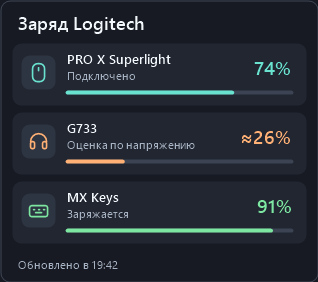

# Logi Battery

Виджет для системного трея Windows 10 и 11. Показывает заряд совместимых устройств Logitech и напоминает, когда пора их зарядить.

## [⬇ Скачать Logi Battery для Windows](https://github.com/Rom1ko315/logi-battery/releases/tag/v1.1.0)

На странице релиза скачайте **LogiBattery-1.1.exe** из раздела **Assets** и запустите его. Программа портативная, работает без G HUB и Logi Options+.



## Использование

- Наведите курсор на значок в трее, чтобы увидеть заряд. Щелчок открывает карточку со всеми обнаруженными устройствами.
- В меню по правому щелчку можно обновить заряд, проверить уведомление и включить автозапуск. Если значок скрыт, найдите его под стрелкой `^` на панели задач.
- Виджет опрашивает устройства раз в две минуты. Когда заряд падает ниже **30%**, Windows показывает напоминание. Оно повторится после восстановления заряда до **33%** и следующего разряда ниже порога.

## Совместимость

Виджет считывает данные по HID++ 1.0 и 2.0. Поддержка зависит от модели, прошивки и способа подключения. Подходят совместимые устройства через приёмники LIGHTSPEED, Unifying, Logi Bolt и некоторые Nano, а также через USB или Bluetooth с доступным HID++.

G PRO Wireless, PRO X Superlight и G733 предусмотрены в коде. Фактическое считывание заряда зависит от доступа Windows к HID-интерфейсу. Знак `≈` обозначает оценку по напряжению. Некоторые устройства сообщают только ступень заряда, например «Низкий» или «Хороший». Напоминание о 30% работает при наличии процента. Устройства без доступных данных о батарее обычно не появляются в карточке.

Виджет выполняет только команды чтения. Для работы ему не требуется интернет.

## Сборка

Запустите из корня репозитория в PowerShell на Windows с .NET Framework 4.8.

```powershell
.\build.ps1
```

Готовый файл появится в `dist\LogiBattery.exe`.

## Лицензия

Проект распространяется по лицензии [MIT](LICENSE).

Справочные материалы по протоколу — [спецификация HID++ 2.0](https://lekensteyn.nl/files/logitech/logitech_hidpp_2.0_specification_draft_2012-06-04.pdf), [приёмники Solaar](https://pwr-solaar.github.io/Solaar/devices/) и [описание показаний G733](https://openlogi.org/hidpp/features/x1f20-adc-measurement).
